### Hey, I'm Robert 👋

I do stuff. Mostly backend, automation and tooling.

Romanian born, Austrian heritage. My (own) company is [Chronic](https://chronic.ro) · and my (legacy) blog is [bert.ro](https://bert.ro)

These days, I do mostly Enterprise work under NDAs and different git accounts.

I've been programming as a profession since 2012, as a hobby since early 2000s. 

Never considered myself anywhere near exceptional. I'm curious about stuff in general, but mostly about stuff that answer deeper questions.

Programming never posed a challenge that way.

What's published here as public are mostly derived from my hobbies and curiosities. 

My privates are twice as many.

No promises for anything, use it as it pleases or annoys you, I don't care.

I'm friendly btw.

        

<picture><source srcset="profile/stats-dark.svg" media="(prefers-color-scheme: dark)" /></picture>
<picture><source srcset="profile/top-langs-dark.svg" media="(prefers-color-scheme: dark)" /></picture>

